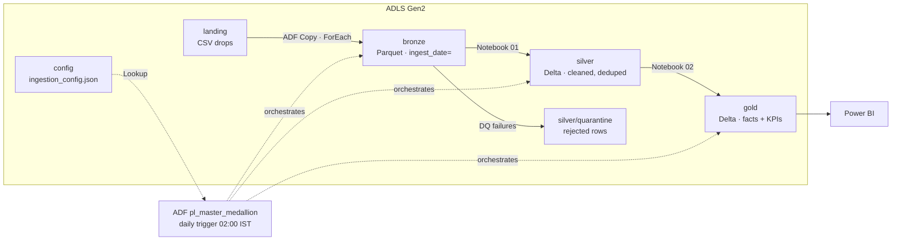
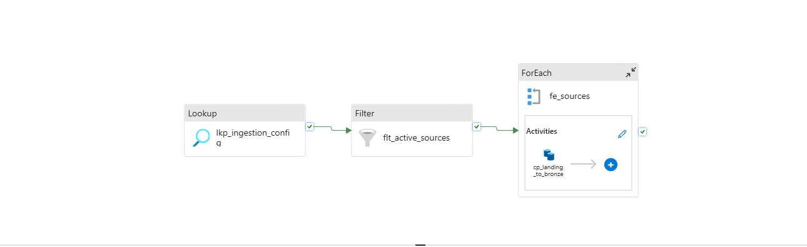
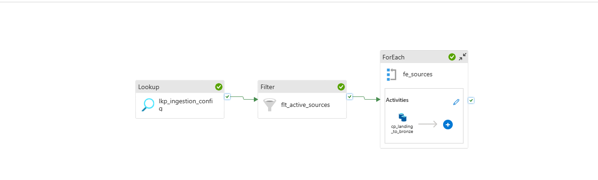
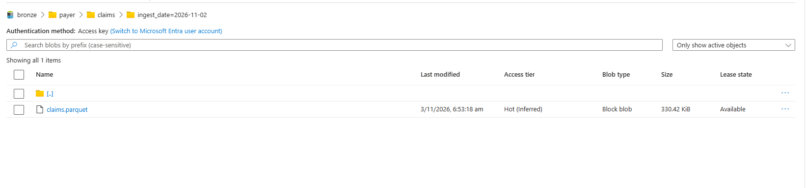
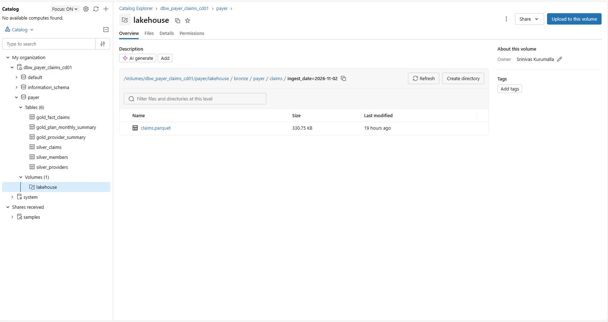
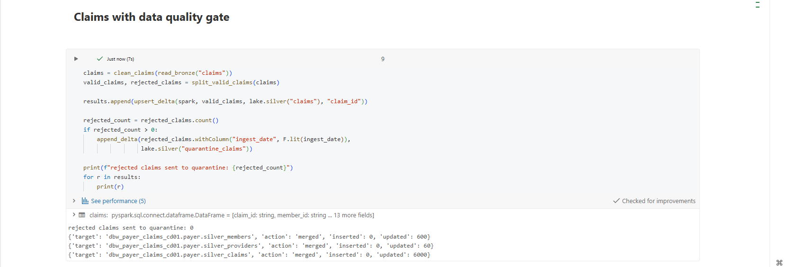
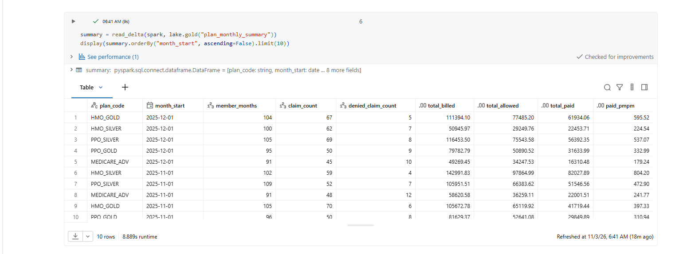
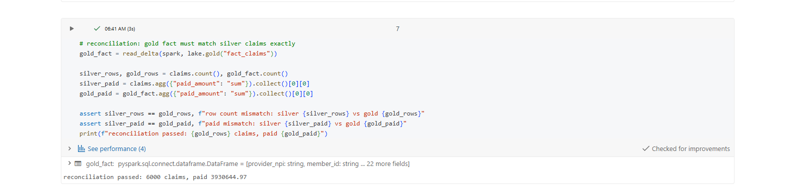

# Medallion Data Pipeline — Azure Data Factory + Databricks

A metadata-driven lakehouse pipeline on Azure for healthcare payer claims. **Azure Data Factory** ingests raw CSV feeds into a bronze layer, and **Databricks (PySpark + Delta Lake)** cleans them into silver and aggregates them into gold reporting tables.

All data is synthetic. No real PHI is used.

---

## Architecture



| Layer | Format | What happens |
| --- | --- | --- |
| **landing** | CSV | Source systems drop files (in real life: SFTP, an API, or a partner feed) |
| **bronze** | Parquet | Raw copy plus `_source_file` and `_ingested_at` lineage columns, partitioned by `ingest_date` |
| **silver** | Delta | Typed, trimmed, deduplicated, quality-checked. MERGE upsert on the primary key. |
| **gold** | Delta | `fact_claims`, `plan_monthly_summary` (PMPM, member months, denial rate), `provider_summary` |

---

## What it demonstrates

| Skill | Implementation |
| --- | --- |
| **Metadata-driven ADF** | Lookup → Filter → ForEach over a JSON control file. Add a new feed by adding a config entry, with no pipeline change. |
| **Parameterized datasets** | One CSV dataset and one Parquet dataset serve every source |
| **Orchestration** | Master pipeline → Execute Pipeline → two Databricks notebooks, with retries, timeouts and Fail activities that carry clear error messages |
| **Re-runnable loads** | `ingest_date` parameter: leave empty for today, or pass a past date to backfill |
| **PySpark** | Window-function deduplication, typed parsing, `try_cast`, joins, aggregations |
| **Delta Lake** | `MERGE` upserts into silver; full-refresh gold; operation metrics returned to ADF |
| **Data quality** | Rejected rows go to a quarantine table with a `reject_reason` instead of failing the load |
| **Testable code** | Business logic lives in `transforms.py` as pure functions, unit-tested locally with pytest |
| **Security** | Managed identity for ADF → ADLS and ADF → Databricks; service principal secrets in a Key Vault-backed secret scope |

---

## Repository layout

```
azure-medallion-pipeline/
├── adf/                        ADF Git-integration layout (set root folder = /adf)
│   ├── linkedService/          ls_adls_gen2, ls_databricks
│   ├── dataset/                ds_config_json, ds_landing_csv, ds_bronze_parquet
│   ├── pipeline/               pl_master_medallion, pl_ingest_bronze
│   └── trigger/                tr_daily_0200_ist
├── databricks/
│   ├── 00_setup_free_edition.py  notebook: creates the Unity Catalog schema + volume
│   ├── 01_bronze_to_silver.py  notebook
│   ├── 02_silver_to_gold.py    notebook
│   ├── transforms.py           pure PySpark business logic
│   ├── delta_utils.py          MERGE / overwrite helpers (paths or UC tables)
│   └── lake_paths.py           where each layer lives, per environment
├── config/ingestion_config.json
├── sample_data/                synthetic CSVs to upload to landing
├── tests/                      9 unit tests (local Spark)
└── requirements-dev.txt
```

---

## Results

The run below used an **Azure free-trial subscription**: ADF on Azure, notebooks on **Azure Databricks serverless compute** with Unity Catalog.

**1. ADF: metadata-driven ingestion (landing → bronze)**







**2. Databricks: bronze → silver → gold**









The raw claims feed has 6,244 rows. Silver holds 6,000 after resubmitted duplicates are removed (latest `loaded_at` wins).

The notebook 01 output above is from a **second run** over the same bronze data. Every row was updated in place and nothing was inserted, which shows the MERGE load is safe to re-run.

---

## Two ways to run it

| | Option A: full Azure orchestration | Option B: the run shown above |
| --- | --- | --- |
| Landing → bronze | ADF copy pipeline | ADF copy pipeline (same) |
| Bronze → silver → gold | ADF runs both notebooks on a Databricks job cluster | Notebooks run on **serverless** compute (Azure Databricks or Databricks Free Edition) |
| Silver / gold storage | Delta paths in ADLS | Unity Catalog managed Delta tables |
| Notebook widget | `environment = azure` | `environment = free_edition` (Unity Catalog mode) |
| Cost | Pay-as-you-go subscription | Free-trial credit, or ₹0 on Free Edition |

`lake_paths.py` holds where each layer lives in each mode. The business logic in `transforms.py` is identical in both.

### Option B: step by step

**Azure (ADF + storage)**

1. Create a storage account with **hierarchical namespace** enabled, and containers `landing`, `bronze`, `config`. Find/replace `stpayerclaimscd01` in `adf/` with your account name.
2. Create a Data Factory. On the storage account, grant the ADF managed identity **Storage Blob Data Contributor**.
3. Upload `config/ingestion_config.json` → `config/`, and each `sample_data/raw_*.csv` → `landing/payer/<entity>/`.
4. ADF Studio → *Manage → Git configuration* → this repo, root folder `/adf`.
5. **Debug** `pl_ingest_bronze` with `ingest_date` = today (yyyy-MM-dd). Three Parquet files land in `bronze/payer/<entity>/ingest_date=.../`.

**Databricks (Azure Databricks serverless or Free Edition)**

6. *Workspace → Create → Git folder* → this repo.
7. Find your catalog: `SHOW CATALOGS` (Azure Databricks names it after the workspace, Free Edition calls it `workspace`). Set the **catalog** widget in each notebook to it.
8. Run `databricks/00_setup_free_edition` once: it creates schema `<catalog>.payer` and volume `lakehouse`.
9. Copy the three Parquet files from ADLS into the volume, keeping the `bronze/payer/<entity>/ingest_date=.../` layout.
10. Run `01_bronze_to_silver` (leave `ingest_date` empty to pick the newest folder), then `02_silver_to_gold`. Notebook 02 ends with a row and amount reconciliation.

*No ADF?* Notebook 00 can copy `sample_data/*.csv` straight into bronze (`load_sample_csv = yes`), and notebook 01 reads CSV or Parquet automatically.

**Next improvement:** replace the manual copy in step 9 with a Unity Catalog **external location** on the ADLS `bronze` container, so the notebooks read ADF's output directly.

### Option A: full Azure orchestration

| Resource | Name used in this repo | Notes |
| --- | --- | --- |
| Storage account | `stpayerclaimscd01` | ADLS Gen2. Containers: `landing`, `bronze`, `silver`, `gold`, `config` |
| Data Factory | `adf-payer-claims-cd01` | Managed identity: **Storage Blob Data Contributor** on storage, **Contributor** on the Databricks workspace |
| Databricks workspace | `dbw-payer-claims-cd01` | Premium tier, pay-as-you-go subscription for job clusters |
| Key Vault | `kv-payer-claims-dev` | Service principal secret, read through a Key Vault-backed secret scope `kv-payer` |

1. Steps 1–5 above, plus containers `silver` and `gold`.
2. Fill in `domain` and `workspaceResourceId` in `ls_databricks.json`, and the Repos path in `pl_master_medallion.json`.
3. Debug `pl_master_medallion`. It passes `environment = azure` to both notebooks.
4. Delete the resource group when finished.

---

## Run the tests locally (no Azure needed)

```bash
python -m venv .venv && source .venv/bin/activate     # Windows: .venv\Scripts\activate
pip install -r requirements-dev.txt                    # needs Java 17+ for Spark
pytest -q
```

```
.........                                                [100%]
9 passed
```

---

## Design notes

- **Why Parquet in bronze and Delta in silver/gold?** Bronze is append-only raw history, so plain Parquet partitions are cheap and simple. Silver needs upserts, which means Delta MERGE.
- **Why keep transforms out of the notebooks?** Notebooks are hard to test. Pure functions in `transforms.py` run the same on a laptop and on a cluster.
- **Quarantine instead of fail:** one bad row shouldn't block 6,000 good ones. Rejected rows are kept with a reason, so they can be fixed and replayed.
- **Gold is rebuilt each run:** the aggregates are small, and a full rebuild guarantees they always match silver. The notebook asserts row-count and amount reconciliation.

---

## Tech stack

Azure Data Factory · Azure Data Lake Storage Gen2 · Azure Databricks · PySpark · Delta Lake · Azure Key Vault · Python · pytest
